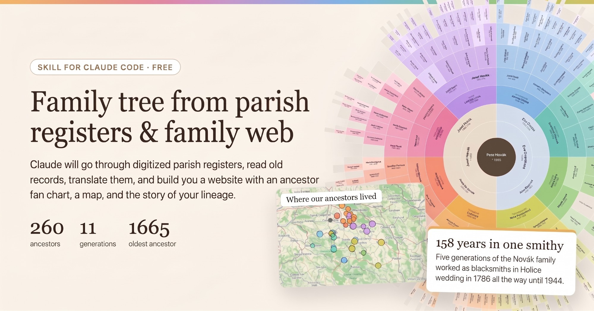

# Genealogy – a Claude Code skill for your family tree

**From family memories, through digitised parish registers and archives, to a beautiful private family website.**

This skill turns [Claude Code](https://claude.com/claude-code) into a patient research companion. You bring what the
family remembers – names, a few dates, old certificates and photos. Claude finds the registers in online archives,
reads the old handwriting (Latin, German, Dutch, French, Czech…), cuts out every entry it uses, writes a transcription
and a translation, keeps a research log, and finally builds a website with a fan chart of your ancestors, a map, family
stories and the original record images behind every fact.

It is made for people who have **never done genealogy and never programmed**. Claude does the technical work; you
contribute knowledge of your family and make the decisions.



**Current version: 0.1.0 (18 Nov 2026).** See [CHANGELOG.md](CHANGELOG.md).

> **Before you start**
>
> This skill **does not replace a genealogist**. It is a tool that can read a lot of registers quickly – and AI
> makes mistakes: it misreads a name, confuses two Johns from the same village, or joins families that do not belong
> together. The skill fights this – every fact has a source and a crop of the original entry, findings are
> cross-checked, an independent second AI model re-reads the difficult entries, and uncertain things are marked as
> such. Still, **you are responsible for your tree**. Use it at your own risk, and ask a professional or a
> genealogical society when the stakes are high (inheritance, publication, disputed lines).

## What you get

- A **project folder** on your own computer with all data in plain text files (people, records, transcriptions,
  research log), the downloaded register crops and your scanned family documents.
- A **research process you can follow**: every search is logged (also the unsuccessful ones), every reading can be
  checked against its image, open questions are listed.
- A **family website** (static, fast, works on phones) with:
  fan chart and pedigree, a page for every ancestor, family pages, the original record crops with transcription and
  translation, a map of where your ancestors lived, curiosities and family stories, statistics, a "how are we related"
  calculator, a research log and a list of open questions – protected by a family question (password gate).
- Optional **separate websites per family side** (e.g. one for your father's ancestors, one for your mother's).

## Where it works

| Region | Support |
|---|---|
| **Czech Republic** (Bohemia, Moravia, Silesia) | Deep: ready-made download tools for several regional archives, guides for all of them. |
| **Belgium** (Flanders, Wallonia, Brussels) | Detailed research guide: civil registration, population registers, parish registers, State Archives portal, FamilySearch, societies. |
| **Austria, Germany, Poland, Slovakia, …** | General workflow with FamilySearch, Matricula, Geneteka, Arolsen Archives, ANNO newspapers. |
| **Anywhere else** | The general method works with any online registers; Claude adapts. Contributions of country guides are welcome – see [docs/adding-a-country.md](docs/adding-a-country.md). |

## What you need

- **Claude Code** (desktop app for Mac/Windows or the command line) and a paid Claude subscription. A family tree is
  long work – plan several evenings; the cheapest *Pro* plan is fine for trying it, a *Max* plan is more realistic
  for a whole tree. You can downgrade afterwards – your data and website stay.
- A computer with **macOS or Windows** (Linux should work but is untested).
- **Python 3, Node.js, ImageMagick and git.** You do not have to install them first – Claude checks what is missing
  and helps you install it.
- For archives that only work in a web browser (and for FamilySearch), the **Playwright** browser plugin for Claude:
  `/plugin install playwright@claude-plugins-official`, then restart Claude Code.
- Optionally a free [Cloudflare](https://www.cloudflare.com) (or Netlify) account to publish the website for your family.

## Installation

### Option A – as a plugin (recommended)
In Claude Code type:
```
/plugin marketplace add petrnetusil/genealogy-skill
/plugin install genealogy@genealogy-skill
```
Restart Claude Code. To get updates automatically, open `/plugin` → **Marketplaces** → `genealogy-skill` →
*Enable auto-update*. Or update manually:
```
claude plugin marketplace update genealogy-skill
claude plugin update genealogy@genealogy-skill
```

### Option B – manually
Download this repository (**Code → Download ZIP** or `git clone`) and copy the folder `skills/genealogy` to
`~/.claude/skills/` (Windows: `C:\Users\<you>\.claude\skills\`), so that you have `~/.claude/skills/genealogy/SKILL.md`.
Restart Claude Code.

## First steps

1. Start Claude Code and say, in any language:
   > I want to build my family tree.

   or type `/genealogy`.
2. Claude checks your computer, creates a project folder (e.g. `~/Genealogy`) and starts asking about your family.
   Have ready what you know about parents, grandparents and great-grandparents, and photos of family documents
   (birth and marriage certificates, death notices, prayer cards, letters).
3. **Next time, open Claude Code directly in the project folder** (`cd ~/Genealogy && claude`, or choose the folder in
   the app). Claude reads where you stopped and continues.

Want to see a website first? Say *"Show me the sample website."* Claude creates a demo project with a fictional family.

A detailed walk-through for beginners is in **[docs/getting-started.md](docs/getting-started.md)**.

## How it works

| Phase | You | Claude |
|---|---|---|
| 0. Setup | approve installing programs | creates the project |
| 1. Family interview | tell what you know, upload documents, ask older relatives | records everything, reads your documents, prepares questions |
| 2. Registers & archives | decide disputed readings | finds the books, downloads and reads entries, makes crops, transcriptions and translations, keeps the research log |
| 3. Stories | add family anecdotes, approve texts | collects curiosities, writes the story of your family |
| 4. Website | look at the preview, say what to change | builds the website |
| 5. Publishing | create a Cloudflare/Netlify account, approve the content | publishes the website behind a family question |

More in [docs/workflow.md](docs/workflow.md) and [docs/website.md](docs/website.md).

### Quality safeguards
- Every fact points to a record; every record has a crop of the original with the exact place highlighted.
- Every record states **who read it and who checked it** – e.g. *read by AI model Claude Opus 5.5, checked by AI model
  Claude Fable 5.2* or *by genealogist N. N.*
- An **independent second model** re-reads uncertain and key entries from enhanced images, automatically every few
  research rounds and whenever readings disagree.
- Automatic **consistency checks**: impossible dates, parents missing in a baptism, a fact after death, duplicate
  ancestors, stories that cite no source.
- **Competing hypotheses** (who was the father?) are tracked as cases with candidates, evidence and probabilities.
- Negative results are logged with their range, so nothing is searched twice and nothing is claimed absent without proof.

## What is in the repository
```
skills/genealogy/
  SKILL.md          the guide Claude follows (phases, rules)
  reference/        detailed guides: installation, reading registers, portals, methodology, data format,
                    stories, privacy, website; countries/ (Czech Republic, Belgium, …)
  methodology/      helper (sub-agent) brief template, sources beyond registers, tips from users
  tools/            Python tools (record crops and highlights, data checks, website export, fan chart,
                    archive downloaders, polite network brake, …)
  template/         project template: empty data, a fictional sample family, the website (Astro)
docs/               guides for people: getting started, workflow, website, privacy, adding a country, FAQ
tests/              tests for the tools
.claude-plugin/     plugin manifest
```

## Privacy
Your project contains personal data about your family. It stays on your computer. The website is protected by a
family question and is not indexed by search engines; without a question set, the tools refuse to publish. This is a
light protection against casual visitors, not a vault – anyone who knows the answer sees everything.
Claude writes only the name and birth year of living people and asks you before publishing anything sensitive
(illegitimacy, illness, crime, causes of death of the recently deceased). On recent certificates it blurs personal
ID numbers. See [docs/privacy.md](docs/privacy.md). If you back up your project to GitHub, use a **private** repository.

## Security
The skill is plain text (instructions for Claude) and a few Python scripts – you can read all of it here.
- **No code runs automatically.** The plugin has no hooks or MCP servers. Scripts run only when Claude needs them,
  and Claude Code asks you first. The one exception is the optional **network guard** (`tools/net_guard.py`), which
  Claude offers when creating a project: before each command it checks that downloads go through the polite network
  brake. It downloads nothing and sends nothing.
- **Polite to archives.** Archives block IP addresses after bursts of requests. All tools share a per-site rate limit
  (`tools/polite.py`) and stop for a while when an archive complains.
- **Where scripts write:** into your project folder, plus a small brake state and an image cache in `~/.cache/`
  (max. 5 GB, can be deleted any time).
- **Where scripts connect:** archive portals, newspaper libraries, OpenStreetMap (map coordinates), the npm registry
  when installing the website, and Cloudflare/Netlify only when you publish. Your data is never sent anywhere else.

## Feedback
Found a misreading, a bug, or have an idea? [Open an issue](https://github.com/petrnetusil/genealogy-skill/issues/new)
(please never post data about living people). While working, Claude keeps a file `notes_for_skill.md` in your project
with improvement ideas – without any family data – which you can send along if you want.

## Acknowledgements
This project is an English, internationalised fork of **[rodokmen-skill](https://github.com/sarsonj/rodokmen-skill)
by Jindřich Šaršon (sarsonj)** – thank you! His Czech skill is the foundation of everything here: the research method,
the tools and the website. I started using it for my own family, then made my own copy with many extensions (second-model
checks, evidence and family checks, competing-hypothesis cases, readable stories and summaries, site variants,
family-document workflow, news pages and more) and translated everything to English so that colleagues abroad can use it.
Several tools and guides are adapted (MIT) from other forks of the original skill – thank you to their authors:
Zbyšek Voda ([rodokmen-plus](https://github.com/zbysekvoda/rodokmen-plus): evidence checks, searched books, sources
beyond registers), Vojtěch Pražák (cases of competing candidates), and the authors of the forks by xsigik
(sieve, contact sheets), xkraust, srameko (victim databases, consent), vmi43 (fan chart poster), vlastimilvasek
and micl79. The individual files name their sources. Thanks also to everyone who shared their experience with the
original skill.

## License
[MIT](LICENSE) – you may use, modify and share it freely; keep the copyright notices of both authors.
